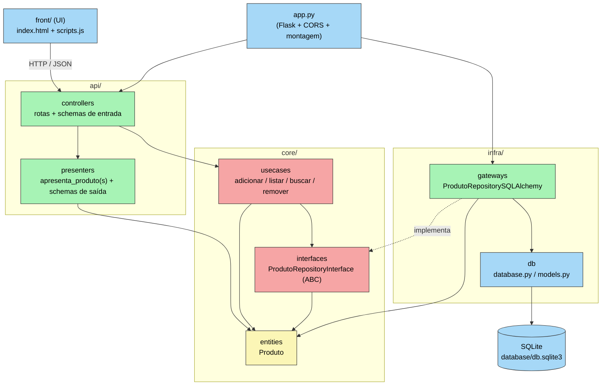
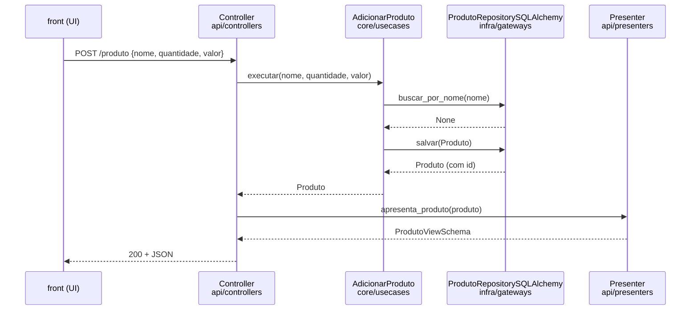

# Clean Architecture na API de Produtos

## Estrutura de pastas

```text
server/
├── app.py                          # ponto de entrada: cria o Flask, CORS e conecta as camadas
├── requirements.txt
│
├── core/                           # regras de negócio, sem Flask nem SQLAlchemy
│   ├── entities/
│   │   └── produto.py              # Produto como classe Python pura (dataclass)
│   ├── interfaces/
│   │   └── produto_repository_interface.py   # contrato (ABC) que o banco precisa cumprir
│   └── usecases/
│       ├── erros.py                # ProdutoJaExiste, ProdutoNaoEncontrado
│       ├── adicionar_produto.py
│       ├── listar_produtos.py
│       ├── buscar_produto.py
│       └── remover_produto.py
│
├── infra/                          # detalhes técnicos de persistência
│   ├── db/
│   │   ├── database.py             # engine, Session, criação do banco (antigo model/__init__.py)
│   │   └── models.py               # ProdutoModel do SQLAlchemy (antigo model/produto.py + base.py)
│   └── gateways/
│       └── produto_repository_sqlalchemy.py   # implementa a interface usando o SQLAlchemy
│
└── api/                            # entrada e saída HTTP
    ├── controllers/                # caminho de IDA: requisição → use case
    │   ├── produto_controller.py   # rotas: validam a entrada, chamam o use case, chamam o presenter
    │   └── produto_schemas.py      # schemas de entrada: ProdutoSchema, ProdutoBuscaSchema
    └── presenters/                 # caminho de VOLTA: entidade → resposta
        ├── produto_presenter.py    # apresenta_produto(s) + ProdutoViewSchema, ListagemProdutosSchema, ProdutoDelSchema
        └── error_presenter.py      # ErrorSchema
```

### Correspondência com o diagrama

| Camada do diagrama | Cor | Diretório |
|---|---|---|
| Entities | amarelo | `core/entities` |
| Use Cases | vermelho | `core/usecases` + `core/interfaces` |
| Controllers, Presenters | verde | `api/controllers`, `api/presenters` |
| Gateways | verde | `infra/gateways` |
| DB | azul | `infra/db` (SQLAlchemy + SQLite) |
| Web | azul | Flask / flask-openapi3, configurado no `app.py` |
| UI | azul | o projeto `front/` (fora da API) |
| Devices, External Interfaces | azul | não se aplicam neste projeto |

## Diagrama de dependências

As setas indicam **quem importa quem**. Todas apontam para dentro, em direção ao `core`, e o `core` não importa nada de `api` nem de `infra`.



O `app.py` é o único arquivo que conhece todas as camadas. Ele cria o repositório concreto (`infra`) e o entrega aos casos de uso (`core`) usados pelos controllers (`api`). Isso é a **injeção de dependência**: o caso de uso recebe "algo que cumpre a interface `ProdutoRepositoryInterface`", sem saber que por trás existe SQLAlchemy.

## Fluxo de uma requisição: `POST /produto`



Se o nome já existir, o caso de uso lança `ProdutoJaExiste` e o controller converte esse erro em `409`. Assim, o `core` não conhece códigos HTTP.

## Schemas: entrada com o controller, saída com o presenter

Os schemas Pydantic só descrevem a **forma** dos dados. Por isso não ganham uma pasta própria; cada um fica com quem o usa:

- **Schemas de entrada** (`ProdutoSchema`, `ProdutoBuscaSchema`) validam o que chega na requisição. Fazem parte do caminho de ida e ficam em `controllers/`.
- **Schemas de saída** (`ProdutoViewSchema`, `ListagemProdutosSchema`, `ProdutoDelSchema`, `ErrorSchema`) são o *View Model* da Clean Architecture: o formato que o presenter produz. Ficam em `presenters/`.

### Onde Schemas e Presenters aparecem

```text
requisição ──► ProdutoSchema ──► use case ──► Produto (entidade) ──► presenter ──► ProdutoViewSchema ──► resposta
               (controller)                   (core)                              (presenter)
```

- **`ProdutoSchema`** é o que **chega** na requisição. Quem recebe é a rota, que tira os dados dele e entrega ao use case.
- **`Produto`** é o que o use case **devolve**. Esse `Produto` é a entidade do `core`, não o modelo do SQLAlchemy.
- **`ProdutoViewSchema`** é o que **sai** na resposta. Quem monta é o presenter, a partir da entidade.

O presenter monta e devolve o próprio schema de saída, em vez de um `dict` solto, e o formato da resposta fica garantido:

```python
def apresenta_produto(produto: Produto) -> ProdutoViewSchema:
    return ProdutoViewSchema(id=produto.id, nome=produto.nome,
                             quantidade=produto.quantidade, valor=produto.valor)
```
